# RESQGO

**Ride safe. Help faster.**

An Android app that notices when a two-wheeler rider crashes and, if the rider cannot answer,
sends their location to emergency contacts by SMS and calls the first one — using the phone's own
SIM, so it works without mobile data.

Built for the phones Indian gig riders actually carry: no Google Maps key needed for the safety
part, no paid cloud service, no internet required to raise the alarm.

**[Download the APK](../../releases/latest)** · [Demo run sheet](DEMO.md) · [Maps notes](MAPS.md)

---

## How it works

Three things must happen together before RESQGO rings. This is what keeps a pothole or a dropped
phone from calling your mother.

1. **A hit** — over 4 g of force
2. **While moving** — the rider was above 15 km/h in the five seconds before
3. **Then stillness** — the phone barely moves for ten seconds afterwards

If a rider taps **I'm OK**, nothing is sent. If nobody answers before the countdown ends, the SOS
goes out and the location is re-sent every two minutes until the rider says they are safe.

---

## What it looks like

### The crash, start to finish

| Watching the ride | The hit | No answer | SOS sent |
| --- | --- | --- | --- |
| 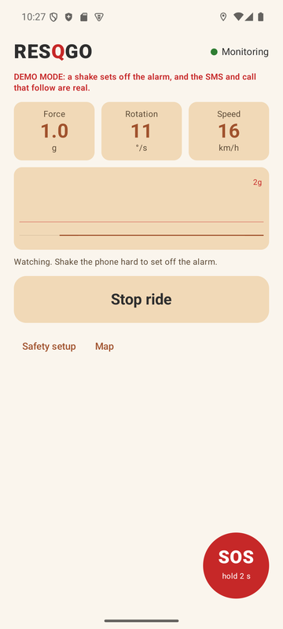 | 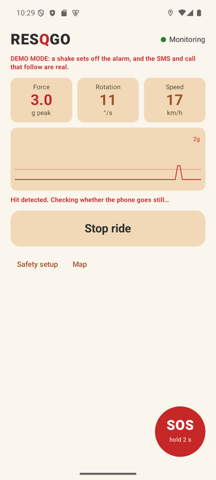 | 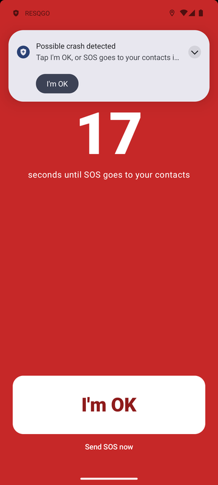 | 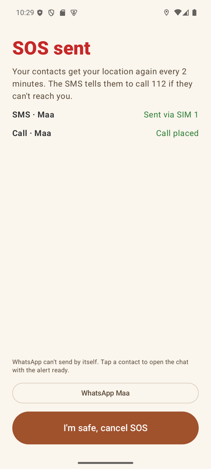 |
| Force, rotation and speed, live | The spike crosses the line and the app starts checking for stillness | The alarm covers whatever app is open, at alarm volume even on silent | Every send reports its own result, so nothing fails quietly |

The call is real — the phone dials the first contact itself:

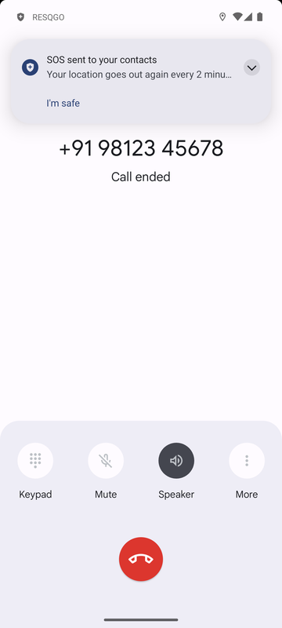

### The rest of the app

| Home | Navigation | Search | Route |
| --- | --- | --- | --- |
| 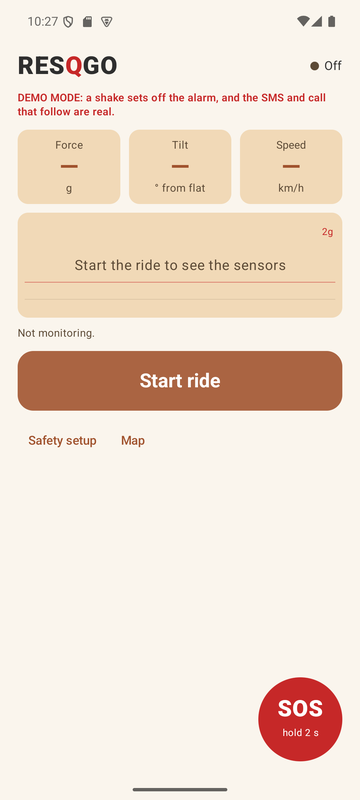 | 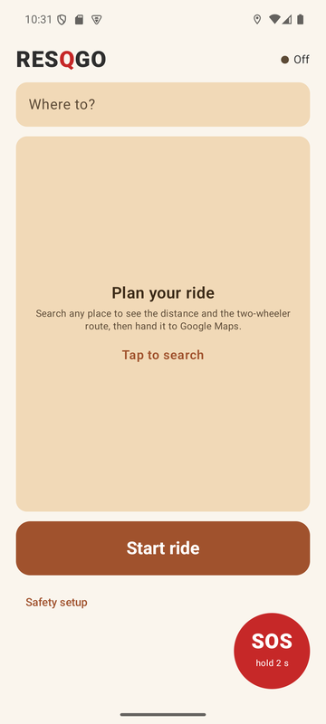 | 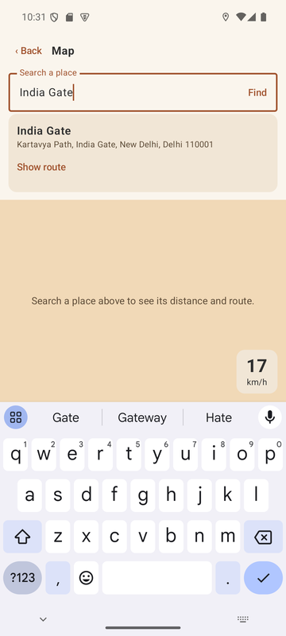 | 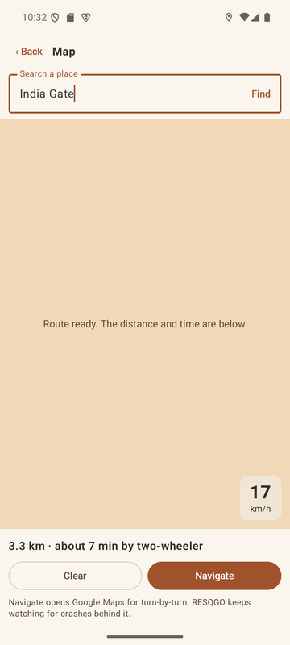 |
| Start a ride with one tap. No destination needed. | Plan a ride, or just go | Google Places finds the destination | Two-wheeler route, then Google Maps takes over the turn-by-turn |

### Setting up

| Contacts and timer | Modes and pilot data |
| --- | --- |
| 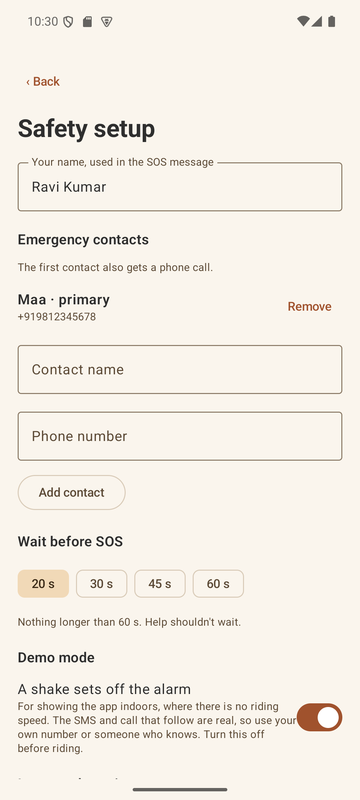 | 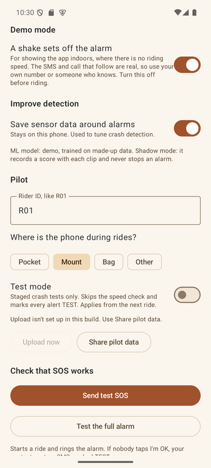 |

---

## What is in it

| | |
| --- | --- |
| **Crash detection** | Plain rules on the accelerometer, running on the phone. No internet, no model needed. |
| **SOS** | SMS and a call through the rider's own SIM. On a dual-SIM phone the app picks the SIM itself and retries on the other one, instead of stopping at a chooser. |
| **WhatsApp** | Opens the contact's chat with the alert already typed. No app may press send for you, so the rider does. |
| **Keeps running** | A foreground service, so monitoring survives the rider switching to Rapido, Zomato or Google Maps. |
| **Manual SOS** | A button that needs a two-second hold, so it cannot fire in a pocket. |
| **After the alert** | Location re-sent every two minutes, and an "I'm safe" message that calls it off. |
| **Navigation** | Place search and a two-wheeler route; turn-by-turn opens in Google Maps. |
| **Pilot tools** | Per-ride diary and labelled sensor clips, uploaded to the owner's Google Drive. |
| **Crash model** | A trained model scores every alarm, in shadow mode: it records, it never stops an alarm. |

---

## Try it

1. Install the APK. Android will warn about an app from outside the Play Store — choose
   **More details → Install anyway**.
2. Allow Location, SMS, Phone and Notifications.
3. In **Safety setup**, add your name and a contact who knows you are testing, and press
   **Send test SOS**. The SMS should arrive before you trust anything else.
4. Set **Battery** to **Unrestricted** for RESQGO, or the phone may stop it mid-ride. On Xiaomi,
   Vivo, Oppo and Realme, turn on **Autostart** too.

To show the app indoors, where there is no riding speed, turn on **Demo mode**: a firm shake then
sets off the alarm. The SMS and call that follow are real. Turn it off before riding.

---

## Building it

Needs Android Studio and a JDK 17.

```
./gradlew assembleDebug        # app/build/outputs/apk/debug/app-debug.apk
./gradlew testDebugUnitTest    # the rules, the SMS path, the model, the polyline
python ml/test_resqgo_ml.py    # the training pipeline, on made-up data
```

Secrets live in `local.properties`, which git ignores:

```
MAPS_API_KEY=...            # optional; search and routes need it, the safety features do not
RESQGO_UPLOAD_URL=...       # optional; where pilot data goes (pilot/Code.gs)
RESQGO_UPLOAD_KEY=...
```

Minimum Android 8.0. Tested on Android 12, 15 and 16.

---

## Where it stands

Pre-pilot. The detection rules and the SOS path work and are covered by tests, and the whole chain
has been run end to end on real phones. What has **not** happened yet is a real-road pilot: false
alarms per hour, battery cost and detection rate are still unmeasured, and until they are, nobody
should rely on this app in place of calling 112.

The crash model shipped in the app is trained on made-up data and runs in shadow mode only. The
tools to collect real data and train on it are in `ml/` and in the app's pilot settings.

---

Final-year project by **Ashutosh Mishra**.
